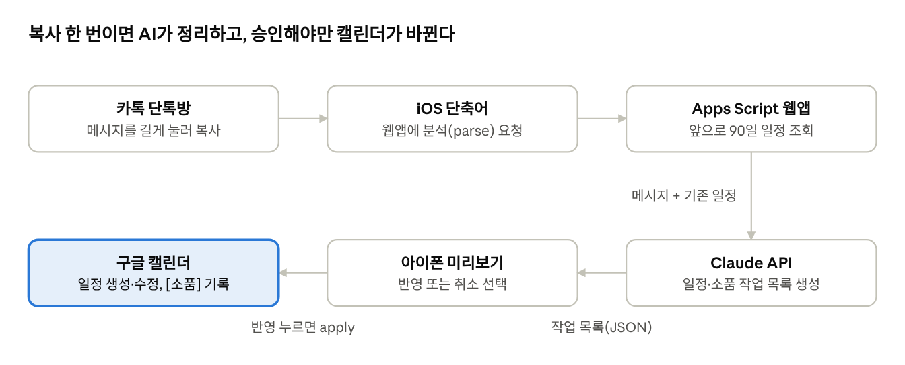

# 카톡 → 구글 캘린더 반자동 반영

카톡 단톡방의 일정 공지·변경·소품 수량 변경을 AI(Claude API)가 읽어 구글 캘린더에 반영합니다.
아이폰 단축어로 보내고 → 미리보기 확인 → **[반영]**을 눌러야 적용됩니다.

## 문서

| 문서 | 대상 |
|---|---|
| [`설치_체크리스트.md`](설치_체크리스트.md) | 설치해 주는 사람 (API 키 발급, Apps Script 배포, 단축어 만들기, 이후 관리) |
| [`친구용_사용설명서.md`](친구용_사용설명서.md) | 실제 사용하는 사람 (사용법, 미리보기 읽는 법) |

## 파일

| 파일 | 역할 |
|---|---|
| `Code.gs` | 웹앱 엔드포인트(parse / apply), 미리보기 문구, `listCalendars` · `testParse` · `resetLastProcessed` |
| `Claude.gs` | Claude API 호출과 프롬프트 |
| `Calendar.gs` | 일정 생성·수정·취소 표시, 설명란 `[소품]` 섹션 관리 |
| `State.gs` | 대화 내보내기 파싱, 중복 처리 방지 |
| `appsscript.json` | 시간대·권한·웹앱 설정 |

## 구조 메모
- 실행 위치: 사용하는 사람의 구글 계정 Apps Script (그 사람의 캘린더 권한으로 동작)
- AI 비용: 스크립트 속성 `CLAUDE_API_KEY`의 소유자에게 청구 — 전용 키 + 월 한도 권장
- 웹앱은 "모든 사용자" 접근이지만 `SHARED_SECRET`이 맞는 요청만 처리
- 분석 결과는 `CacheService`에 10분 보관 후 승인 시에만 반영
- 대화 내보내기는 `LAST_TS`(마지막 처리 메시지 시각) 이후만 분석

## 설정 파일
- `Config.example.gs`를 `Config.gs`로 복사해서 값을 채우세요. `Config.gs`는 `.gitignore`에 들어 있어 저장소에 올라가지 않습니다.
- 또는 Apps Script의 **스크립트 속성**에 같은 이름으로 넣어도 됩니다 (스크립트 속성이 우선).
- clasp를 쓴다면 `clasp create` 또는 `clasp clone <scriptId>`로 본인의 `.clasp.json`을 만드세요.
